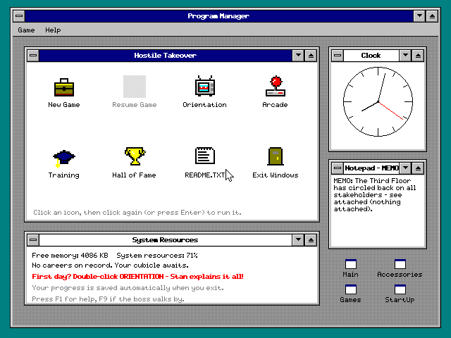
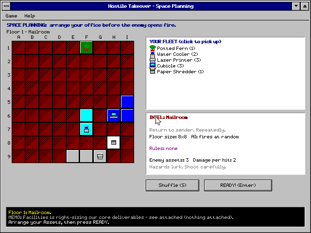
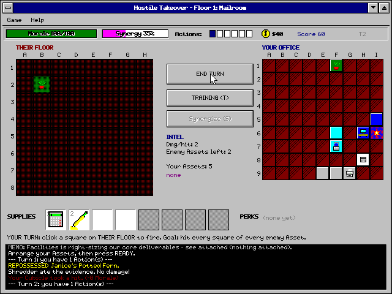
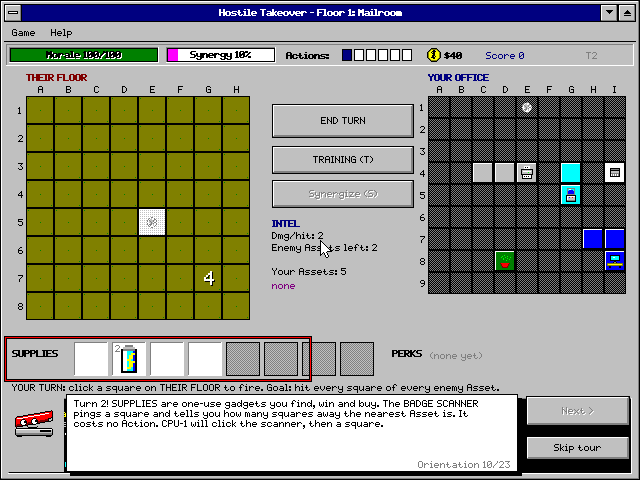
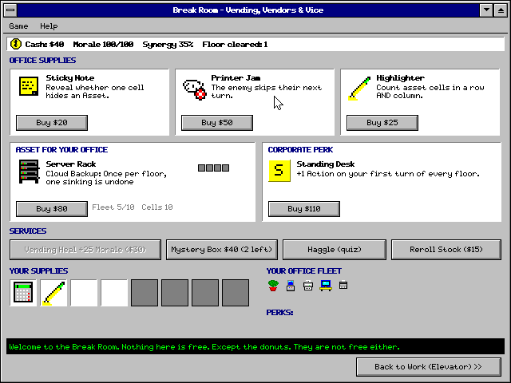
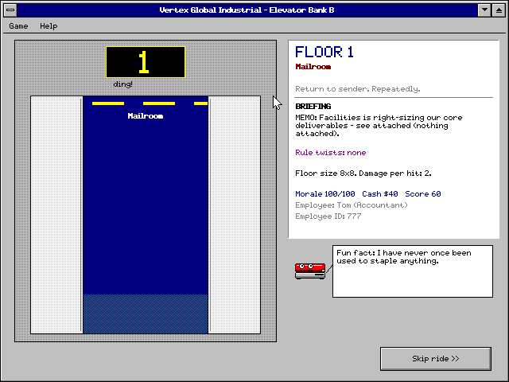
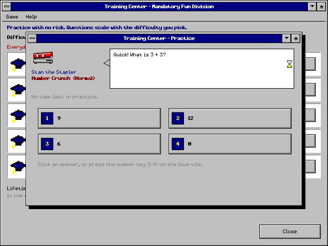
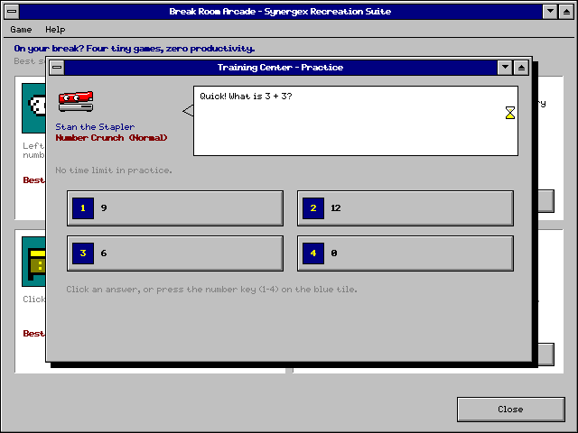

# HOSTILE TAKEOVER — The Office Warfare Simulator (for Windows 3.1™-style desktops)

A roguelike / Battleship / retro-edutainment mashup, in plain C99 + Win32 GDI, built with gcc.
One .exe, no dependencies beyond stock Windows DLLs. Full concept: `GAME_DESIGN.md`.

## Screenshots

| | |
|---|---|
|  |  |
| **Program Manager** | **Space Planning** |
|  |  |
| **Battle** | **Orientation Video (tutorial)** |
|  |  |
| **Break Room shop** | **Elevator briefing** |
|  |  |
| **Mandatory Training** | **Break Room Arcade** |

## Run
`HostileTakeover.exe` (64-bit) or `HostileTakeover32.exe`. Settings and the Hall of Fame live in `TAKEOVER.INI` next to the exe.

## Build
* Windows + MinGW gcc: run `build.bat` (or `mingw32-make`).
* Linux cross-compile: `make cross`.

## Play
Open Program Manager → New Game. Fire memos at THEIR FLOOR (click a cell), survive on YOUR OFFICE,
answer Mandatory Training for extra Actions, fill the Synergy meter, climb 13 floors, beat the CEO.
Keys: Space end turn · T training · S synergize · 1-8 supplies · R rotate · Esc cancel ·
F1 help · F2 sound · F9 BOSS KEY · F11 fullscreen. Right-click a cell to flag it.

## Layout
* `src/ht.h` shared types, `data.c` content tables, `board.c` boards + enemy AIs, `battle.c` rules/perks/shop/events,
  `quiz.c` procedural questions, `gfx.c`/`font.c`/`art.c` software renderer (16-colour palette), `audio.c` synth,
  `ui*.c` Windows 3.1 interface, `main_win32.c` platform layer.
* `tools/art.py` generates `art.c` (all sprites) + a preview sheet.
* `main_test.c` logic fuzz tester, `main_sim.c` headless UI simulator (scripted input → screenshots, autopilot).

## v1.2 changes
- Orientation Video (desktop icon / Help menu): two CPUs play a real round while Stan explains everything. Offered on first New Game.
- Break Room Arcade (desktop icon / Games group): PaperSweeper, Cable Management, Filing Cabinet, Reply-All Panic, with saved best scores.
- Game auto-saves (TAKEOVER.SAV beside the exe) and resumes via the Resume Game icon; Resume survives visiting Training etc. Practice progress is saved too.
- Training: difficulty now really changes questions; numbered answer tiles; Submit button for typing.
- Mystery Box limited to 2 per visit with escalating price and full refunds (fixes the free-stuff exploit).
- Stan icon on the .exe (res/stan.ico, built via windres).
